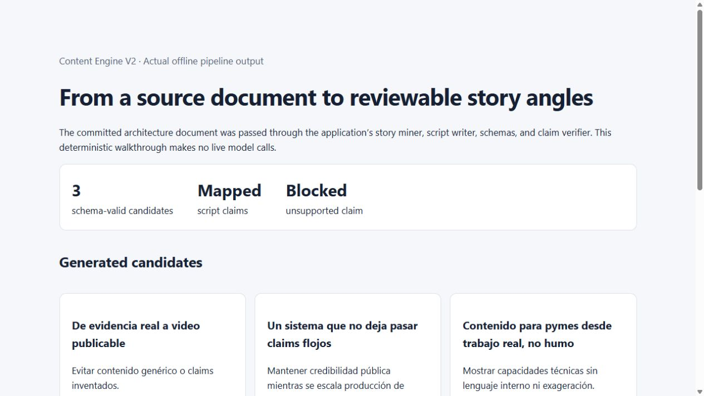
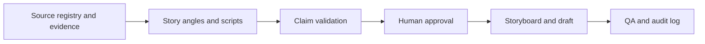

# Content Engine V2

Evidence-backed content production with structured AI outputs, explicit review gates, and an auditable job state machine.

The engine turns approved evidence into story angles, scripts, storyboards, and draft artifacts. Every public claim needs an evidence mapping; a human must approve the script and storyboard before the job advances.

## Interactive English demo

[Run the interactive demo](demo/README.md) to explore the approved product interface, local example workflows and downloadable outputs. The isolated demo uses English throughout and preserves the original application below. See its README for the exact example boundaries and passkey acceptance status.

## Demonstration



See the [reproducible walkthrough and its validation scope](docs/DEMO.md).

## Project direction and use

[Kenneth Yepez](https://github.com/kennethyepez) directs product requirements, architecture, integration, validation, and deployment. AI coding agents implement code under his direction.

See [use and licensing](LICENSE.md), [contributing](CONTRIBUTING.md), and [security reporting](SECURITY.md).

## Architecture



| Layer | Implementation |
| --- | --- |
| Application and API | Next.js route handlers in `apps/web` |
| Contracts and state | TypeScript, Zod schemas, job transitions, and evidence validation in `packages/core` |
| Storage | SQLite through explicit repository functions |
| AI integration | Provider adapters and crew orchestration in `packages/providers` and `services/crew` |
| Drafts and quality | Remotion-based rendering in `packages/video`; review logic in `packages/qa` |
| Evaluation | Golden fixtures and assertions in `evals` |

Provider output must pass schema and business validation before database writes. See [architecture](docs/architecture.md), [provider contracts](docs/provider-contracts.md), and the [QA rubric](docs/qa-rubric.md).

## Review the engineering

- [Artifact schemas](packages/core/src/schemas/artifacts.ts): contracts between generation, review, and persistence.
- [Source registry validation](packages/core/src/source-registry/validator.ts): admissible evidence before collection.
- [Crew orchestrator](packages/providers/src/ai/crew-orchestrator.ts): provider integration and structured generation.
- [Evaluation runner](evals/run-evals.ts): evidence mappings, unsupported-claim rejection, privacy checks, and draft QA.
- [Provider security regression tests](packages/providers/tests/proxy-agent-security.test.ts).

## Reproduce checks in an isolated clone

The [CI workflow](.github/workflows/ci.yml) defines the complete verification environment: Node.js 24, FFmpeg, a renderer browser, isolated SQLite/output paths, and deterministic fallback mode.

Start with dependency installation and static checks:

```bash
npm ci
npm run typecheck
```

The remaining commands are `npm test`, `npm run migrate`, `npm run smoke`, `npm run eval`, and `npm run build`. Use the CI environment settings when reproducing the full sequence. Migration and smoke commands write to the configured database and output paths; use a disposable local directory.

For application development, review [.env.example](.env.example) before running `npm run dev`. Configure your own providers through the environment.

## Evidence and current scope

The [dated historical report](evals/reports/archive/2026-06-02.json) preserves a June 2, 2026 run with five of six checks passing. Current results are generated by `npm run eval` and published as artifacts by the [CI workflow](.github/workflows/ci.yml); see [report provenance](evals/reports/README.md).

Deterministic checks exercise contracts and gates. They do not measure real-provider generation quality, latency, or cost. A recorded end-to-end provider run remains needed for those claims.

The draft renderer produces an H.264 MP4 and timeline JSON under `outputs/drafts/{job_id}/{script_id}`, plus a PNG contact sheet under `outputs/contact-sheets/{job_id}/{script_id}`. CI exercises this real renderer. Final export and publishing endpoints remain blocked. Passing QA alone does not publish content.

## API and approval gates

- `GET /api/health`
- `GET /api/providers/status`
- `POST /api/jobs`, `GET /api/jobs`, `GET/PATCH /api/jobs/:id`
- `POST/GET /api/jobs/:id/evidence`
- `POST /api/jobs/:id/collect-evidence`
- `POST/GET /api/jobs/:id/story-angles`
- `POST /api/jobs/:id/select-angle`
- `POST/GET /api/jobs/:id/scripts`
- `POST /api/jobs/:id/verify-claims`
- `POST /api/jobs/:id/approve-script`, `POST /api/jobs/:id/request-script-revision`, `POST /api/jobs/:id/reject-script`
- `POST/GET /api/jobs/:id/production-plan`
- `POST /api/jobs/:id/storyboard-preview`, `GET /api/jobs/:id/storyboard`
- `POST /api/jobs/:id/approve-storyboard`, `POST /api/jobs/:id/request-storyboard-revision`
- `POST /api/jobs/:id/render-draft`, `GET /api/jobs/:id/drafts`, `GET /api/jobs/:id/drafts/:draftId`
- `POST/GET /api/jobs/:id/qa`
- `POST /api/jobs/:id/approve-publish`
- `POST /api/jobs/:id/export-final`, `POST /api/jobs/:id/publish` intentionally blocked in MVP slice
- `GET /api/jobs/:id/audit-log`

Story angles require at least one public-safe visual evidence item with owned/licensed/generated/authorized rights.

Gate A approval requires valid script schema, claim-evidence mappings, no unsupported claims, no prohibited public language, and explicit reviewer understanding of the angle/benefit.

Storyboard approval precedes draft rendering. Final export remains blocked in this MVP slice.

QA Gate B reviews the draft artifacts. Publishing requires explicit approval, and final export/publish endpoints remain blocked until their own implementation slice.

## Reviewed delivery

See the [delivery workflow](docs/DELIVERY.md) for acceptance criteria, commit boundaries, identified AI/human review, protected integration, and source provenance.
