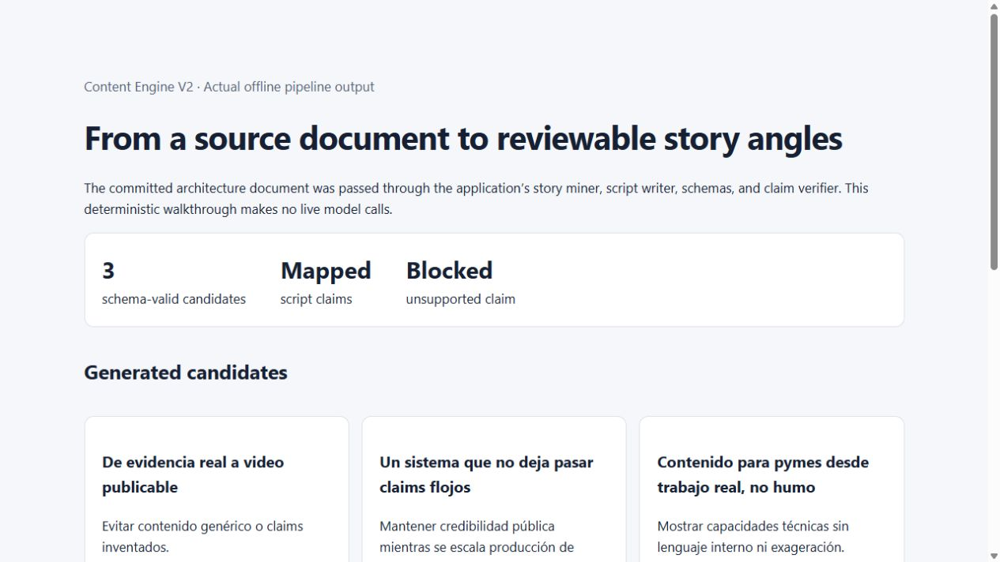

# Evidence-to-script workflow



## Reproduce

Node 24 and FFmpeg. Full renderer acceptance runs on Ubuntu CI; Windows native Remotion FFmpeg can fail in this host environment.

Use an isolated checkout and environment.

```bash
npm ci
npm run typecheck
npm test
npm run eval
npm run demo
```

Serve the generated files locally:

```bash
python -m http.server 8000 --bind 127.0.0.1 --directory docs/examples
```

Open `http://127.0.0.1:8000/walkthrough.html`.

## What the example establishes

The example runs the actual story miner, script writer, and claim verifier over the committed architecture document. It produces three candidate angles and demonstrates rejection of an unsupported claim. It uses the deterministic fallback: no live model calls, no human approval, no quality benchmark. CI separately exercises the renderer and publishes current evaluation JSON. The dated June report remains in evals/reports/archive.

The screenshot records the visible output of this workflow. It does not establish behavior outside the stated scope. Generated evidence and source examples are preserved alongside the walkthrough; current CI runs provide commit-specific checks.
