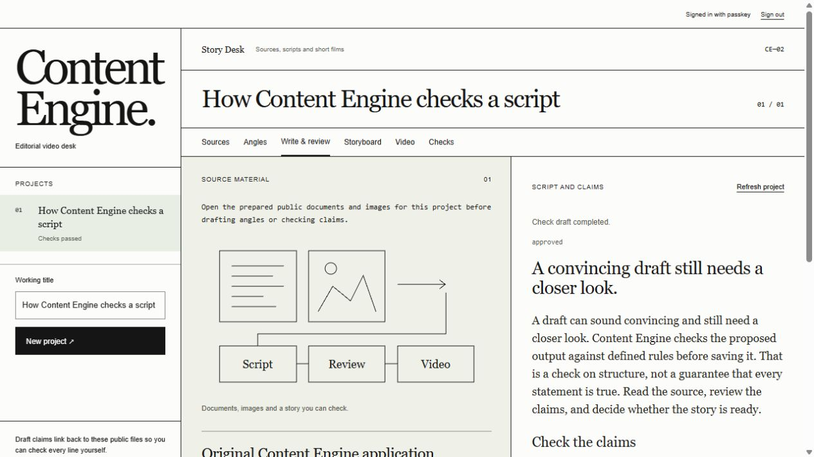
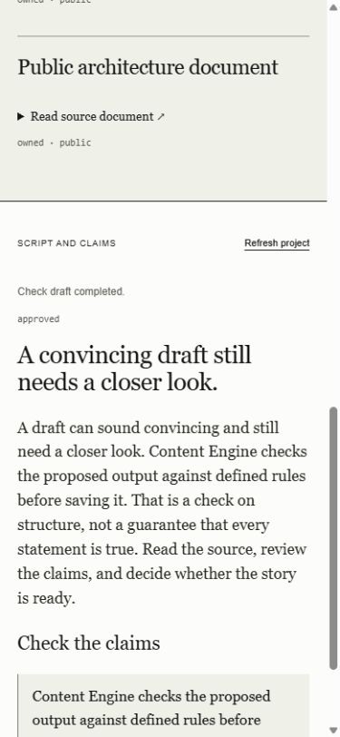
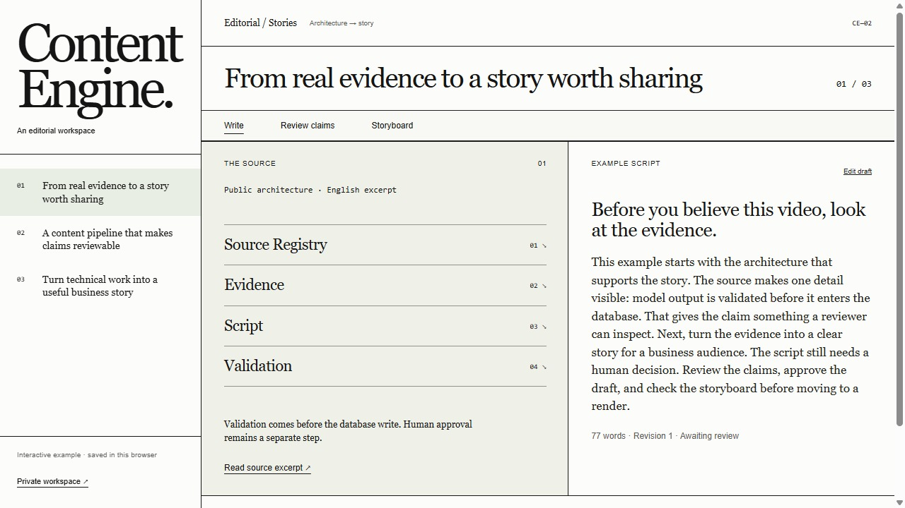

# Content Engine V2 — product review

The original Next.js application connects project sources, AI-assisted writing, human review, storyboarding and video playback. The current editorial interface uses the same engine and protected project data. [Open the production workspace](https://content.kennethyepez.com/app) · [Follow the workflow](ORIGINAL-APP.md).

## Current editorial workspace

This unmodified browser capture shows the real authenticated project and its reviewed script on November 22, 2026. The illustration explains the workflow; the protected original app capture and architecture document are the project's source material. A screenshot does not establish audio quality or unrestricted public access. See the [acceptance record](ORIGINAL-APP.md#acceptance-status).

## Earlier authored examples

The captures and recording below show the retained authored-example interface at `/workspace/`. They are historical material, not captures of the current original-app workflow.

## Earlier desktop

## Earlier phone

## Try it

Follow the [original app guide](ORIGINAL-APP.md) for the current production workflow. The separate [authored-example setup](../demo/README.md) documents the preserved older interface. Access to private projects uses the existing passkey account.

These are unmodified browser captures of that earlier interface.

[Watch the workspace recording](examples/workspace-walkthrough.mp4). It contains actual browser frames with idle waits shortened and no narration. It demonstrates the authored workflow; it does not record a live provider or a completed human authentication flow.
